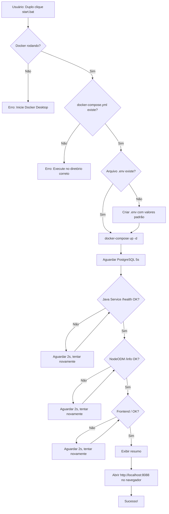

# Scripts de Automação

Documentação completa dos scripts de automação para inicialização, parada e gerenciamento do FuncoesODM.

> **Modo standalone.** Estes scripts não estão no repositório do SGI — ficaram no `ImgDrone/`, fora
> do git. No SGI o drone sobe pelo compose da plataforma: ver
> [README.md § Dentro do SGI](../README.md#dentro-do-sgi).

## 📁 Scripts Disponíveis

### Windows

- **`start.bat`** - Inicialização rápida (duplo clique)
- **`stop.bat`** - Parada rápida (duplo clique)
- **`menu.bat`** - Menu interativo completo
- **`start.ps1`** - Script PowerShell de inicialização
- **`stop.ps1`** - Script PowerShell de parada
- **`status.ps1`** - Verificador de status dos serviços
- **`menu.ps1`** - Menu interativo PowerShell
- **`check-requirements.ps1`** - Validador de pré-requisitos
- **`criar-atalhos.vbs`** - Criador de atalhos na área de trabalho

### Linux/WSL

- **`start.sh`** - Inicialização completa
- **`stop.sh`** - Parada completa
- **`menu.sh`** - Menu interativo
- **`status.sh`** - Verificador de status
- **`check-requirements.sh`** - Validador de pré-requisitos

---

## 🚀 Uso Rápido

### Windows

**Modo Mais Simples:**
```bash
# Duplo clique nos arquivos:
start.bat       # Inicia tudo
stop.bat        # Para tudo
menu.bat        # Menu completo
```

**Modo PowerShell:**
```powershell
.\start.ps1     # Inicia com diagnósticos detalhados
.\stop.ps1      # Para com opção de limpar volumes
.\menu.ps1      # Menu interativo
.\status.ps1    # Verifica status atual
.\check-requirements.ps1  # Valida sistema
```

**Criar Atalhos na Área de Trabalho:**
```bash
# Duplo clique em:
criar-atalhos.vbs
```

### Linux/WSL

```bash
chmod +x *.sh   # Dar permissão de execução (primeira vez)

./start.sh      # Iniciar aplicação
./stop.sh       # Parar aplicação
./menu.sh       # Menu interativo
./status.sh     # Verificar status
./check-requirements.sh  # Validar sistema
```

---

## 📋 Funcionalidades Detalhadas

### start.ps1 / start.sh

**O que faz:**
1. ✅ Verifica se Docker está rodando
2. ✅ Verifica arquivo `docker-compose.yml`
3. ✅ Cria arquivo `.env` se não existir
4. ✅ Inicia todos os containers (`docker-compose up -d`)
5. ✅ Aguarda serviços ficarem prontos (health checks):
   - PostgreSQL (5 segundos)
   - Java Service (http://localhost:8080/api/v1/health)
   - NodeODM (http://localhost:3000/info)
   - Frontend (http://localhost:8088)
6. ✅ Exibe resumo de URLs e credenciais
7. ✅ Abre aplicação no navegador automaticamente

**Tempo estimado:** 30-90 segundos (primeira execução mais lenta devido ao build de imagens)

**Saída esperada:**
```
================================================
    FuncoesODM - Inicializacao Completa
================================================

[OK] Docker verificado
[INFO] Iniciando containers Docker...
[INFO] Aguardando servicos ficarem prontos...
[OK] PostgreSQL iniciado
[OK] Java Service esta pronto!
[OK] NodeODM esta pronto!
[OK] Frontend esta pronto!

================================================
         Todos os servicos iniciados!
================================================

Status dos Servicos:
   Frontend:     http://localhost:8088
   Backend API:  http://localhost:8080
   NodeODM:      http://localhost:3000
   PostgreSQL:   localhost:5433

Credenciais de teste:
   Usuario: admin
   Senha:   admin123
```

---

### stop.ps1 / stop.sh

**O que faz:**
1. ✅ Pergunta se deseja limpar volumes (dados)
2. ✅ Para todos os containers
3. ✅ (Opcional) Remove volumes do PostgreSQL e uploads

**Opções:**
- **Opção 1 (padrão)**: Para containers, **preserva dados**
- **Opção 2**: Para containers e **remove TODOS os dados** (irreversível)

**Dados que são removidos na Opção 2:**
- ❌ Projetos cadastrados
- ❌ Imagens enviadas
- ❌ Resultados de processamento
- ❌ Banco de dados

**Saída esperada:**
```
================================================
      FuncoesODM - Parada dos Servicos
================================================

Deseja limpar os volumes (dados do banco e uploads)?
  [1] Nao - apenas parar os containers (padrao)
  [2] Sim - limpar todos os dados (CUIDADO: irrecuperavel!)

Escolha (1 ou 2): 1

[INFO] Parando containers...
[OK] Containers parados (dados preservados)
```

---

### status.ps1 / status.sh

**O que faz:**
1. ✅ Lista status de todos os containers
2. ✅ Testa conectividade HTTP de cada serviço
3. ✅ Verifica PostgreSQL com `pg_isready`
4. ✅ Lista volumes de dados
5. ✅ Mostra uso de disco Docker

**Saída esperada:**
```
================================================
       FuncoesODM - Status dos Servicos
================================================

Containers Docker:
NAME              STATUS          PORTS
funcoesodm-nginx  Up 5 minutes    0.0.0.0:8088->80/tcp
funcoesodm-java   Up 5 minutes    0.0.0.0:8080->8080/tcp
funcoesodm-nodeodm Up 5 minutes   0.0.0.0:3000->3000/tcp
funcoesodm-db     Up 5 minutes    0.0.0.0:5433->5432/tcp

Testando Conectividade:
  Frontend (8088): [OK] Online
  Backend (8080):  [OK] Online
  NodeODM (3000):  [OK] Online
  PostgreSQL:      [OK] Online
```

---

### menu.ps1 / menu.sh

Menu interativo centralizado com todas as operações:

```
================================================
          FuncoesODM - Menu Principal
================================================

  [1] Iniciar todos os servicos
  [2] Parar todos os servicos
  [3] Verificar status dos servicos
  [4] Ver logs em tempo real
  [5] Verificar requisitos do sistema
  [6] Abrir aplicacao no navegador
  [7] Limpar dados (volumes)
  [0] Sair

================================================
```

**Funcionalidades:**
- Navegação numérica (1-7)
- Volta automaticamente ao menu após cada operação
- Opção de sair (0)
- Logs em tempo real (Ctrl+C para sair)

---

### check-requirements.ps1 / check-requirements.sh

**O que verifica:**
1. ✅ Docker instalado (versão)
2. ✅ Docker daemon rodando
3. ✅ Docker Compose instalado (versão)
4. ✅ Arquivos essenciais do projeto:
   - `docker-compose.yml`
   - `frontend/Dockerfile`
   - `backend/Dockerfile`
   - `docker/nodeodm/Dockerfile`
5. ✅ Portas disponíveis:
   - 8088 (Frontend)
   - 8080 (Backend)
   - 3000 (NodeODM)
   - 5433 (PostgreSQL)
6. ✅ Espaço em disco (mínimo 10 GB recomendado)
7. ✅ Memória RAM livre (mínimo 4 GB recomendado)

**Saída esperada:**
```
================================================
    FuncoesODM - Verificacao de Requisitos
================================================

Verificando Docker...
  [OK] Docker version 24.0.7

Verificando Docker daemon...
  [OK] Docker daemon esta rodando

Verificando Docker Compose...
  [OK] Docker Compose version v2.23.0

Verificando arquivos do projeto...
  [OK] docker-compose.yml
  [OK] frontend/Dockerfile
  [OK] backend/Dockerfile
  [OK] docker/nodeodm/Dockerfile

Verificando portas disponiveis...
  [OK] Porta 8088 (Frontend) disponivel
  [OK] Porta 8080 (Backend) disponivel
  [OK] Porta 3000 (NodeODM) disponivel
  [OK] Porta 5433 (PostgreSQL) disponivel

Verificando espaco em disco...
  [INFO] Disco C: 125.45 GB livres de 256.00 GB

Verificando memoria RAM...
  [INFO] RAM: 8.32 GB livres de 16.00 GB

================================================
  SISTEMA PRONTO PARA EXECUTAR A APLICACAO!
================================================
```

---

### criar-atalhos.vbs (Windows)

**O que faz:**
1. ✅ Cria 3 atalhos na área de trabalho do Windows:
   - `[START] FuncoesODM.lnk` → Inicia aplicação
   - `[STOP] FuncoesODM.lnk` → Para aplicação
   - `[OPEN] FuncoesODM.lnk` → Abre no navegador

**Como usar:**
```bash
# Duplo clique em criar-atalhos.vbs
```

**Resultado:**
Três atalhos aparecem na área de trabalho com ícones do PowerShell.

---

## 🔧 Arquitetura dos Scripts

### Estrutura de Chamadas (Windows)

```
start.bat (Duplo clique)
    ↓
PowerShell -ExecutionPolicy Bypass
    ↓
start.ps1 (Lógica principal)
    ↓
docker-compose up -d
    ↓
Health checks (loops)
    ↓
Abre navegador
```

### Fluxo de Inicialização Detalhado



---

## ⚠️ Considerações Importantes

### 🚨 **NÃO USE EMOJIS EM CÓDIGO**

**❌ NUNCA FAÇA ISSO:**
```powershell
# ERRADO - Causa erro de parser no PowerShell
Write-Host "✅ Serviço iniciado com sucesso!" -ForegroundColor Green
Write-Host "🚀 Abrindo aplicação..." -ForegroundColor Blue
```

**✅ FAÇA ISSO:**
```powershell
# CORRETO - Use marcadores ASCII
Write-Host "[OK] Servico iniciado com sucesso!" -ForegroundColor Green
Write-Host "[INFO] Abrindo aplicacao..." -ForegroundColor Blue
```

**Por quê?**
1. **PowerShell no Windows**: Parser falha com caracteres UTF-8/emojis
2. **Encoding problems**: UTF-8 com BOM causa `Token inesperado` errors
3. **Compatibilidade**: CMD/Batch não renderizam emojis corretamente
4. **VBScript**: Não suporta caracteres Unicode estendidos

**Marcadores recomendados:**
- `[OK]` - Sucesso
- `[ERRO]` - Erro
- `[AVISO]` - Aviso/Atenção
- `[INFO]` - Informação

**Linhas decorativas:**
Use ASCII simples em vez de box-drawing characters:
```
================================================
===  Use igual ou hífen para linhas        ===
================================================
```

### Encoding de Arquivos

**PowerShell (.ps1):**
- Encoding: **ASCII** ou **UTF-8 sem BOM**
- Nunca: UTF-8 com BOM (causa parser errors)

**Batch (.bat):**
- Encoding: **ASCII** ou **Windows-1252**
- Evite caracteres acentuados quando possível

**Shell Script (.sh):**
- Encoding: **UTF-8** (sem BOM)
- Compatível com emojis, mas evite para consistência

### Caminhos WSL/Windows

Scripts `.bat` usam `pushd "%~dp0"` para lidar com caminhos UNC:

```batch
@echo off
pushd "%~dp0"          # Muda para diretório do script
PowerShell ...         # Executa comando
popd                   # Volta ao diretório original
```

Isso resolve o erro `Não há suporte para caminhos UNC` ao executar de `\\wsl.localhost\...`

---

## 🐛 Solução de Problemas

### "Docker não está rodando"

**Erro:**
```
[ERRO] Docker nao esta rodando!
Inicie o Docker Desktop e tente novamente.
```

**Solução:**
1. Abra Docker Desktop
2. Aguarde o ícone da baleia ficar verde
3. Execute o script novamente

---

### "Porta já está em uso"

**Erro:**
```
Error starting userland proxy: listen tcp4 0.0.0.0:8088: bind: address already in use
```

**Solução:**
```powershell
# Windows: Encontrar processo usando a porta
netstat -ano | findstr :8088
taskkill /PID <numero_do_pid> /F

# Linux/WSL
lsof -i :8088
kill -9 <pid>
```

Ou altere a porta no `docker-compose.yml`.

---

### "Serviços não ficam prontos"

**Sintoma:**
```
[30/30] Aguardando Java Service...
[ERRO] Java Service nao respondeu no tempo esperado
```

**Solução:**
1. Verifique logs:
   ```bash
   docker-compose logs java-service
   ```
2. Verifique memória/CPU disponível
3. Reinicie Docker Desktop
4. Limpe cache do Docker:
   ```bash
   docker system prune -a --volumes
   ```

---

### "Token inesperado na expressão" (PowerShell)

**Erro:**
```
ParserError: Token '✅' inesperado na expressão
```

**Causa:** Emojis ou caracteres UTF-8 com BOM no arquivo `.ps1`

**Solução:**
1. Remova todos os emojis
2. Use marcadores ASCII: `[OK]`, `[ERRO]`, `[INFO]`
3. Salve arquivo com encoding ASCII ou UTF-8 sem BOM
4. Veja seção **"NÃO USE EMOJIS EM CÓDIGO"** acima

---

### "CMD não suporta caminhos UNC"

**Erro:**
```
CMD.EXE foi iniciado tendo o caminho acima como pasta atual.
Não há suporte para caminhos UNC.
```

**Solução:** Scripts `.bat` já incluem `pushd/popd` para resolver isso automaticamente. Se o problema persistir, copie o projeto para um caminho Windows nativo (ex: `C:\projetos\funcoesODM`).

---

## 🔄 Fluxo de Desenvolvimento

### Modificando Scripts

1. **Edite o arquivo**
   ```bash
   code start.ps1  # Ou seu editor preferido
   ```

2. **Teste isoladamente**
   ```powershell
   # Windows
   .\start.ps1
   
   # Linux
   ./start.sh
   ```

3. **Verifique erros**
   - ❌ Nunca adicione emojis
   - ✅ Use `[OK]`, `[ERRO]`, `[INFO]`, `[AVISO]`
   - ✅ Teste em ambos Windows e Linux se possível

4. **Documente mudanças**
   - Atualize este arquivo (SCRIPTS.md)
   - Adicione comentários no código

---

## 📚 Referências

- [Docker Compose CLI Reference](https://docs.docker.com/compose/reference/)
- [PowerShell Best Practices](https://learn.microsoft.com/powershell/scripting/developer/cmdlet/cmdlet-development-guidelines)
- [Bash Scripting Guide](https://tldp.org/LDP/abs/html/)
- [VBScript Reference](https://learn.microsoft.com/previous-versions/t0aew7h6(v=vs.85))

---

## 📝 Changelog

### 2026-02-06
- ✅ Removidos todos os emojis dos scripts PowerShell e Batch
- ✅ Substituídos por marcadores ASCII (`[OK]`, `[ERRO]`, `[INFO]`, `[AVISO]`)
- ✅ Adicionado `pushd/popd` para suporte a caminhos UNC
- ✅ Documentação completa criada (SCRIPTS.md)
- ✅ Adicionada seção "NÃO USE EMOJIS EM CÓDIGO"

### Histórico Anterior
- Scripts criados com funcionalidade completa
- Health checks implementados
- Menu interativo adicionado
- Criador de atalhos VBScript
