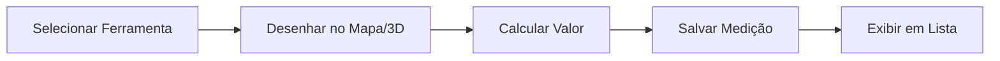

# Measurement Tab - Sistema de Medições Integradas

## 📋 Visão Geral

Componente modular para realização de medições em diferentes tipos de dados fotogramétricos.

## 🎯 Funcionalidades

### Fontes de Dados Suportadas

1. **🗺️ Ortofoto 2D**
   - Visualização de mapa ortorretificado
   - Medições planas (distância, área)
   - Integração com Leaflet/OpenLayers
   - Ferramentas de desenho 2D

2. **🏔️ DSM/DTM (Elevação)**
   - Modelo Digital de Superfície
   - Modelo Digital de Terreno
   - Análise de elevação
   - Cálculo de volumes
   - Perfis transversais

3. **☁️ Nuvem de Pontos 3D**
   - Visualização 3D com Potree/Three.js
   - Medições volumétricas
   - Altura de objetos
   - Navegação 3D orbital/FPS

## 🏗️ Arquitetura

```
measurement-tab/
├── measurement-tab.component.ts      # Coordenador principal
├── measurement-tab.component.html    # Template com seletor
├── measurement-tab.component.scss    # Estilos modulares
└── README.md                         # Esta documentação

Visualizadores Integrados:
├── orthophoto-viewer/               # Ortofoto 2D
├── dem-viewer/                      # DSM/DTM
└── pointcloud-viewer/               # Nuvem 3D
```

## 🔧 Estrutura de Dados

### Inputs

```typescript
@Input() projectId: number;          // ID do projeto
@Input() task: ProcessingTask;      // Tarefa com outputs
```

### State Management

```typescript
selectedDataSource: signal<DataSourceType>;  // 'orthophoto' | 'dsm' | 'pointcloud'
measurements: signal<MeasurementData[]>;     // Lista de medições
isLoading: signal<boolean>;                  // Estado de carregamento

// URLs dos dados
orthophotoUrl: signal<string | null>;
dsmUrl: signal<string | null>;
dtmUrl: signal<string | null>;
pointcloudUrl: signal<string | null>;
```

## 🔄 Fluxo de Funcionamento

### 1. Inicialização

```typescript
ngOnInit() {
  detectAvailableData()  // Detecta outputs da tarefa
    ↓
  buildDataUrls()       // Constrói URLs para visualizadores
    ↓
  autoSelectDataSource() // Seleciona primeira fonte disponível
}
```

### 2. Troca de Visualizador

```typescript
onDataSourceChange() {
  selectedDataSource.set(newValue)
    ↓
  template renderiza novo visualizador
    ↓
  visualizador carrega seus dados
    ↓
  ferramentas de medição são ativadas
}
```

### 3. Realização de Medições



## 📐 Tipos de Medição

| Tipo | Ícone | Dados Suportados | Descrição |
|------|-------|------------------|-----------|
| Distância | 📏 | Todos | Mede distância entre 2+ pontos |
| Área | ⬜ | 2D (Ortofoto/DSM) | Calcula área de polígono |
| Volume | 📦 | DSM/Nuvem 3D | Calcula volume sob superfície |
| Altura | ↕️ | DSM/Nuvem 3D | Mede diferença de altitude |

## 🛠️ Ferramentas Disponíveis

### Barra de Ferramentas
- **📏 Distância**: Linha entre pontos
- **⬜ Área**: Polígono fechado
- **📦 Volume**: Superfície 3D
- **↕️ Altura**: Diferença de elevação

### Ações
- **↩️ Desfazer**: Remove último ponto
- **🗑️ Limpar**: Remove todas medições

## 💾 Persistência

```typescript
interface MeasurementData {
  id: string;                    // UUID único
  name: string;                  // Nome da medição
  type: 'distance' | 'area' | 'volume' | 'height';
  value: number;                 // Valor calculado
  unit: string;                  // Unidade (m, m², m³)
  dataSource: string;            // Fonte de dados usada
  coordinates: any[];            // Pontos da medição
  metadata?: any;                // Dados adicionais
  createdAt: Date;               // Timestamp
}
```

## 🔌 Integração com Visualizadores

### Orthophoto Viewer

```html
<app-orthophoto-viewer
  [projectId]="projectId"
  [center]="mapCenter()"
  [zoom]="mapZoom()">
</app-orthophoto-viewer>
```

**Features:**
- Mapa Leaflet interativo
- Ferramentas de desenho
- Medições 2D precisas
- Georreferenciamento automático

### DEM Viewer

```html
<app-dem-viewer
  [projectId]="projectId">
</app-dem-viewer>
```

**Features:**
- Renderização de elevação
- Curvas de nível dinâmicas
- Perfis transversais
- Análise de inclinação

### Pointcloud Viewer

```html
<app-pointcloud-viewer
  [projectId]="projectId">
</app-pointcloud-viewer>
```

**Features:**
- Renderização 3D otimizada
- Medições volumétricas
- Navegação orbital
- Colorização por elevação/RGB

## 🎨 Customização

### Estilos
Os estilos estão organizados em blocos SCSS:
- `.measurement-header` - Cabeçalho e seletor
- `.measurement-viewer` - Área de visualização
- `.measurement-toolbar` - Ferramentas
- `.measurement-results` - Painel de resultados

### Adicionando Novo Visualizador

1. Criar componente do visualizador
2. Adicionar import no measurement-tab
3. Adicionar opção no select
4. Adicionar case no template
5. Implementar detecção de dados

## 📊 Exemplo de Uso

```typescript
// No componente pai (results-viewer)
<app-measurement-tab
  [projectId]="123"
  [task]="currentTask">
</app-measurement-tab>

// O task deve conter outputs:
task = {
  id: 456,
  outputs: {
    orthophoto: 'orthophoto.tif',
    dsm: 'dsm.tif',
    pointCloud: 'pointcloud.laz'
  }
}
```

## 🚀 Roadmap

### Próximas Implementações
- [ ] Exportação de medições (CSV, GeoJSON, DXF)
- [ ] Medições com elevação (3D sobre ortofoto)
- [ ] Comparação de medições
- [ ] Anotações e marcações
- [ ] Templates de medição recorrentes
- [ ] API de integração com backend
- [ ] Histórico de medições
- [ ] Colaboração multi-usuário

## 🐛 Troubleshooting

### Visualizador não aparece
- ✅ Verificar se `task.outputs` contém dados
- ✅ Checar console para erros de URL
- ✅ Confirmar que projectId e taskId são válidos

### Medições não funcionam
- ✅ Verificar se fonte de dados está selecionada
- ✅ Testar ferramentas individualmente
- ✅ Verificar console para erros do visualizador

### Performance

Para otimizar:
- Limitar número de medições simultâneas
- Usar LOD para nuvem de pontos grandes
- Implementar paginação na lista de medições

## 📝 Notas de Desenvolvimento

- Usar signals do Angular para reatividade
- Lazy loading dos visualizadores pesados
- Gerenciamento de memória para 3D
- Cache de tiles para performance

## 🤝 Contribuindo

Para adicionar novas funcionalidades:
1. Manter estrutura modular
2. Documentar novos tipos de medição
3. Adicionar testes unitários
4. Atualizar este README

---

**Versão**: 2.0.0  
**Última atualização**: 7 de Fevereiro de 2026  
**Autor**: funcoesODM Team
